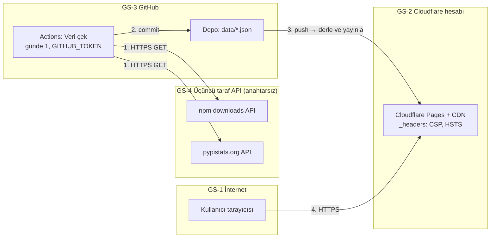

# Kütüphane Popülerlik Karşılaştırıcı

> BVA 2245 Kullanıcı Arayüzü Tasarımı · Bulut Bilişim ve Siber Güvenlik
> Müesser İrem Gecici · 2516016027

Bir yazılım/veri bilimi eğitim programının müfredat ekibi için, hangi kütüphanelerin öğretileceğine karar vermeye yardım eden canlı veri ürünü. npm ve PyPI paketlerinin günlük indirme sayılarını karşılaştırır.

*Müşteri kurgusaldır; ürün gerçek bir kurumla yapılmış bir çalışma değildir.*

## Canlı link

**https://kutuphane-populerlik.pages.dev** (Cloudflare Pages)

## Durum (ara kontrol – 26 Ekim 2026)

- [x] Herkese açık depo
- [x] Otomatik veri çekimi: GitHub Actions, günde 1 kez (`.github/workflows/fetch-data.yml`)
- [x] Arayüz taslağı: [`docs/taslak.png`](docs/taslak.png)
- [x] Başlangıç arayüzü bulutta yayında (grafik, KPI, tablo)
- [x] Güvenlik başlıkları ve CSP (`_headers`), `/.well-known/security.txt`
- [ ] Arayüz, ileri özellik, durumlar (27–28 Ekim)
- [ ] Hesap güvenliği (MFA/passkey, IAM), branch protection, secret scanning, ZAP taraması (27–28 Ekim)
- [ ] Kullanıcı testi, portfolyo vaka sayfası, demo videosu (30 Ekim)

## Mimari



- Veri her çalıştırmada mevcut JSON ile tarihe göre birleştirilir; böylece kaynakların verdiği aralığın ötesinde kendi zaman serimiz birikir.
- Rate limit'e uymak için istekler arasında 2 sn beklenir, iş akışı günde yalnızca 1 kez çalışır.
- Veri commit'i `main`'e düştüğünde Cloudflare Pages siteyi otomatik yeniden yayınlar.
- API çalışmazsa ürün depodaki son başarılı JSON ile açılır.

## Güvenlik ve Altyapı

| Konu | Uygulama |
| --- | --- |
| Gizli anahtarlar | Ürün anahtar gerektiren hiçbir kaynak kullanmaz; istemci kodunda, depoda ve log'larda anahtar yoktur. Dağıtım token'ı da yoktur: Cloudflare Pages, GitHub uygulaması üzerinden yayınlar. CI yalnızca GitHub'ın kısa ömürlü `GITHUB_TOKEN`'ını kullanır. |
| En az yetki | Cloudflare GitHub uygulaması yalnızca bu depoya erişebilir (Only select repositories). `fetch-data.yml` yalnızca `contents: write` ister; veriyi depoya yazmak için gereklidir. |
| Kod olarak altyapı | `wrangler.toml` (proje adı, çıktı klasörü), `_headers` (güvenlik başlıkları), `scripts/build_site.sh` (yayınlanacak dosyaların izin listesi). Panelden yapılan: Pages projesinin GitHub'a bağlanması ve derleme komutu. |
| Web güvenliği | HTTPS zorunlu, HSTS; CSP `script-src 'self'` (inline script/stil yok); `X-Content-Type-Options`, `Referrer-Policy`, `Permissions-Policy`, `frame-ancestors 'none'`. Güvenlik açığı bildirimi: [`/.well-known/security.txt`](.well-known/security.txt). |
| Yayınlanan dosyalar | Yalnızca `index.html`, `assets/`, `data/`, `.well-known/`. `scripts/`, `docs/`, `.github/` yayınlanmaz. |
| Maliyet | Cloudflare Pages ve GitHub Actions ücretsiz katman: 0 TL. |

Not: Ders için önce Azure for Students denendi; üniversite hesabının Azure portalına erişimi kurum tarafından engellendiği için (26.10.2026, "Bu kaynağa erişiminiz yok") ödevde izin verilen Cloudflare ücretsiz katmanına geçildi.

## Veri kaynakları ve lisans

| Kaynak | Bağlantı | Not |
| --- | --- | --- |
| npm downloads API | https://github.com/npm/registry/blob/main/docs/download-counts.md | Anahtarsız, son 18 aya kadar günlük veri |
| pypistats.org API | https://pypistats.org/api/ | Anahtarsız, son ~180 gün; PyPI BigQuery verisinden türetilmiştir |

Gösterilen veriler toplulaştırılmış indirme sayılarıdır; kişisel veri içermez.

## Kurulum

```bash
git clone https://github.com/Miremgecici/kutuphane-populerlik.git
cd kutuphane-populerlik
python scripts/fetch_data.py   # data/npm.json ve data/pypi.json oluşur
python -m http.server 8000     # http://localhost:8000
```

Python 3.10+ yeterlidir, ek paket gerekmez.

## CV cümlesi

*(Final teslimde eklenecek)*

## Yapay zekâ kullanım beyanı

| Araç | Ne için | Nasıl değiştirdim |
| --- | --- | --- |
| Claude (Anthropic) | Ödev yönergesini özetleme, veri çekme script'i ve GitHub Actions iş akışının ilk taslağı, README iskeleti, arayüz taslağı | *(doldurulacak)* |
| Claude (Anthropic) | Başlangıç arayüzü (`index.html`, `assets/`), güvenlik başlıkları (`_headers`), `wrangler.toml`, `security.txt`, mimari diyagram, Cloudflare Pages kurulumu | *(doldurulacak)* |
