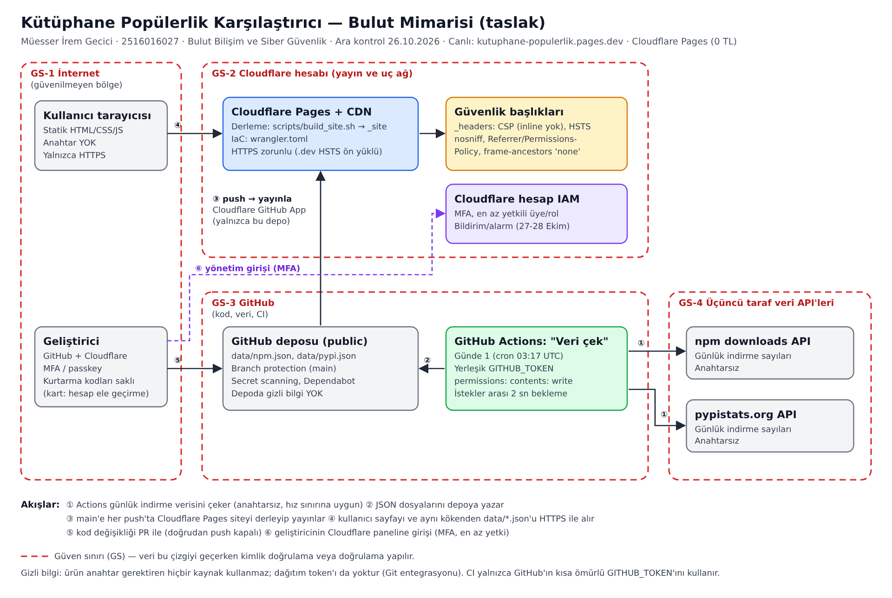

# Tehdit modeli (STRIDE)

Ürün: Kütüphane Popülerlik Karşılaştırıcı · Hazırlayan: Müesser İrem Gecici (2516016027) · Tarih: 28.10.2026

## Veri akış diyagramı (DFD)

| No | Akış | Kaynak → Hedef | Geçtiği güven sınırı |
| --- | --- | --- | --- |
| ① | İndirme sayılarını çekme (HTTPS GET, anahtarsız) | GitHub Actions → npm / pypistats API | GS-3 → GS-4 |
| ② | JSON'u depoya yazma (PR ile) | GitHub Actions → GitHub deposu | GS-3 içinde |
| ③ | Push sonrası derleme ve yayın | GitHub deposu → Cloudflare Pages | GS-3 → GS-2 |
| ④ | Sayfa ve `data/*.json` isteği (HTTPS) | Kullanıcı tarayıcısı → Cloudflare Pages | GS-1 → GS-2 |
| ⑤ | Kod değişikliği (PR) | Geliştirici → GitHub | GS-1 → GS-3 |
| ⑥ | Yönetim girişi (MFA) | Geliştirici → GitHub ve Cloudflare panelleri | GS-1 → GS-2 / GS-3 |

## Risk puanlama

Risk = Olasılık (1–5) × Etki (1–5). 1–5 düşük, 6–12 orta, 15–25 yüksek.
"Önce" önlemler alınmadan önceki, "Kalan" önlemlerden sonraki puandır.

## Tehditler

| # | STRIDE | Tehdit | Akış | Önce (O×E) | Alınan önlemler | Kalan (O×E) |
| --- | --- | --- | --- | --- | --- | --- |
| T1 | **S** Kimlik sahteciliği | **Geliştiricinin GitHub hesabının ele geçirilmesi** (kimlik avı, zayıf/tekrar kullanılan şifre) — *kart tehdidi* | ⑤ ⑥ | 4×5 = **20** | TOTP ile 2FA, kurtarma kodları çevrimdışı, oturum ve uygulama erişim incelemesi, main dalı kuralı (PR zorunlu, force push yasak), gitleaks, Cloudflare uygulaması tek depoyla sınırlı. Ayrıntı aşağıda | 1×5 = **5** |
| T2 | **S** Kimlik sahteciliği | **Cloudflare hesabının ele geçirilmesi** — *kart tehdidi* | ⑥ | 3×5 = **15** | 2FA, Super Administrator yalnızca hesap yönetimi için, okuma rolüyle ayrı kimlik, denetim günlüğü (audit log), ödeme yöntemi tanımlı değil | 1×4 = **4** |
| T3 | **T** Kurcalama | main dalına onaysız / kötü niyetli kod veya veri push edilmesi | ② ⑤ | 3×4 = **12** | Ruleset: doğrudan push kapalı, PR zorunlu, force push ve dal silme yasak; otomatik veri bile PR ile geliyor | 1×4 = **4** |
| T4 | **T** Kurcalama | Tedarik zinciri: kullanılan bir GitHub Action'ın etiketi değiştirilip kötü kod çalıştırılması | ① ② | 2×5 = **10** | Tüm Actions commit SHA'sı ile sabitlendi; Dependabot haftalık güncelleme PR'ı açıyor; iş akışlarında `permissions: {}` | 1×4 = **4** |
| T5 | **T / E** | XSS: veri kaynağından gelen metnin sayfada script olarak çalışması | ④ | 2×4 = **8** | CSP `script-src 'self'` (inline yok), metinler `textContent` ile yazılıyor, `innerHTML` yok | 1×3 = **3** |
| T6 | **I** Bilgi ifşası | API anahtarı / token'ın depoya, istemci koduna veya log'a sızması | ② ④ | 2×4 = **8** | Ürün anahtar kullanmıyor; gitleaks (her push + haftalık), GitHub secret scanning + push protection; runbook hazır | 1×3 = **3** |
| T7 | **D** Hizmet engelleme | Veri API'lerinin çökmesi veya hız sınırı uygulaması | ① | 3×3 = **9** | Son başarılı JSON depoda kalır, site onu gösterip uyarır; service worker önbelleği; günde 1 çalışma + 2 sn bekleme; izleme 48 saatten eski veride alarm verir | 2×2 = **4** |
| T8 | **D** Hizmet engelleme | Siteye yoğun trafik / DoS ve buna bağlı maliyet | ④ | 2×3 = **6** | Statik site, Cloudflare CDN ve DDoS koruması; ücretsiz katman, ödeme yöntemi yok; GitHub bütçe uyarısı 0 USD | 1×2 = **2** |
| T9 | **E** Yetki yükseltme | İş akışının fazla yetkiyle çalışması veya girdi enjeksiyonu (script injection) ile `GITHUB_TOKEN`'ın kötüye kullanılması | ② | 2×4 = **8** | Varsayılan izin yok, izinler iş bazında; `pull_request_target` kullanılmıyor; ZAP etiket girdisi regex ile doğrulanıyor; girdiler `env` üzerinden aktarılıyor | 1×3 = **3** |
| T10 | **R** İnkâr | Kimin neyi değiştirdiğinin izlenememesi | ② ③ ⑥ | 2×2 = **4** | Tüm değişiklikler PR ve commit geçmişinde; GitHub güvenlik günlüğü, Cloudflare audit log, Actions çalışma kayıtları | 1×2 = **2** |
| T11 | **I / T** | Clickjacking: sitenin görünmez bir çerçeveye gömülmesi | ④ | 2×2 = **4** | `frame-ancestors 'none'` ve `X-Frame-Options: DENY` | 1×1 = **1** |

## Kart tehdidi ayrıntısı: geliştirici ve bulut hesabının ele geçirilmesi (T1, T2)

**Neden en yüksek risk:** Ürünün kendisinde gizli bilgi yok. Bu yüzden saldırgan için en kısa yol hesabın kendisi: GitHub hesabını ele geçiren, koda zararlı script ekleyip Cloudflare üzerinden tüm ziyaretçilere dağıtabilir. Cloudflare hesabını ele geçiren siteyi değiştirebilir veya kapatabilir.

**Saldırı senaryoları**

| Senaryo | Nasıl olur | Önleyen kontrol |
| --- | --- | --- |
| Kimlik avı (phishing) | Sahte "GitHub giriş" sayfası şifreyi ve TOTP kodunu çalar | Şu an TOTP 2FA: şifre tek başına yetmez. TOTP gerçek zamanlı aracı sitelerle çalınabildiği için sonraki adım alan adına bağlı **passkey** (sahte sitede çalışmaz) |
| Zayıf / tekrar kullanılan şifre | Başka bir sitenin sızıntısındaki şifre denenir | Benzersiz, parola yöneticisiyle üretilmiş şifre + MFA zorunlu |
| Telefon kaybı | MFA cihazı kaybolur, hesaba erişilemez | Kurtarma kodları çevrimdışı saklanır |
| Oturum çerezi çalınması | Kötü amaçlı tarayıcı eklentisi oturumu çalar | Oturum listesi düzenli incelenir, tanınmayan oturumlar kapatılır |
| Fazla yetkili uygulama / token | Unutulmuş bir OAuth uygulaması veya eski token kötüye kullanılır | Erişim incelemesi: yetkili uygulamalar ve token'lar listelenir, gereksizler kaldırılır; Cloudflare uygulaması tek depoyla sınırlı |
| Kök hesabın günlük kullanımı | Super Administrator ile her gün giriş yapmak saldırı yüzeyini büyütür | Super Administrator yalnızca hesap yönetimi için; günlük inceleme ayrı, okuma yetkili kimlikle |

**Tespit:** GitHub ve Cloudflare'in yeni oturum e-postaları, GitHub güvenlik günlüğü (security log), Cloudflare audit log, izleme iş akışının başlık / içerik değişikliği alarmı.

**Doğrulama:** Kontrollerin uygulanması ve "en az yetkili rolün yapamadığı işlem" testi [hesap-guvenligi.md](hesap-guvenligi.md) dosyasında, ekran görüntüleriyle.

**Kalan risk (5):** TOTP 2FA çalınan şifreyi tek başına işe yaramaz hâle getirir; gerçek zamanlı kimlik avına karşı passkey daha güçlüdür ve sonraki adımdır. Diğer kalan risk, cihazın kendisinin ele geçirilmesi (kötü amaçlı yazılım) ve kurtarma kodlarının kaybolması. Bunlar için güncel işletim sistemi ve kodların fiziksel olarak güvenli saklanması gerekiyor.
